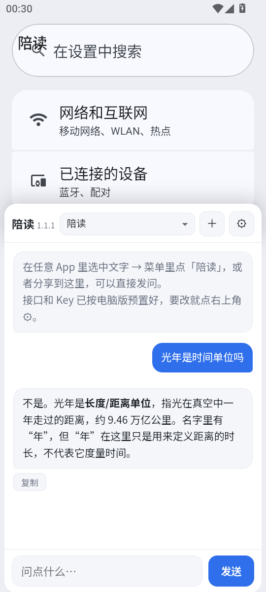

# AI 陪读 · 安卓版（PeiduDroid）

把 [AI 陪读小窗](https://github.com/yxh790820/ai-peidu) 搬到手机上：**选中文字 → 点「陪读」→ 半屏小窗弹出来，原来的读书 App 还在上面**，问完点一下就退回，接着看。



> WebView 壳（界面是一个单文件 HTML）+ 原生只做三件事：系统入口、流式转发、窗口形态。APK 约 3.8 MB，手机不用装 Python / Termux / 任何运行库。

## 和电脑版的区别

| 能力 | 电脑版 | 安卓版 |
|---|---|---|
| 唤起 | `Alt+1` 全局热键取词 | 选中文字 → 系统菜单「陪读」，或分享文字/图片过来 |
| 形态 | 桌面小窗 + 托盘常驻 | **悬浮小窗**：可拖动、可调大小、位置记忆 |
| 公式 | matplotlib 画成 PNG | **KaTeX** 矢量渲染（分数根号上下标都清楚） |
| 存笔记 | 一键写 Obsidian | 暂未接入 |
| 全局热键 | Alt+1 / Alt+2 | 无热键，用系统入口替代 |

## 功能

- **划词问**：任意 App 里长按选中文字 → 菜单里点「陪读」→ 小窗自动带着这段文字发问，答完点上面的原 App 区域就退回，**对话和上下文都保留**
- **分享问**：别的 App 分享文字或图片给「陪读」，同样自动提问
- **悬浮小窗**：卡片顶部的小横杠按住可整块拖动，底边中间短横条按住可改高度，松手即记，下次唤出还是那个位置
- **九个提示词档位**：陪读 / 翻译 / 润色 / 总结 / 拼音+简单解释 / 古文今译 / 古文纯译 / 截图转公式 / 维基百科
- **任意 OpenAI 兼容服务**：DeepSeek、本机 llama.cpp / Strata / Ollama / OneAPI 都行；附加请求参数支持 JSON（例如 `{"thinking":{"type":"disabled"}}` 关掉思考）
- **KaTeX 公式**：`$...$`、`$$...$$`、`\(...\)`、`\[...\]` 都能渲染，中文不会变方框
- 深色/浅色主题（可跟随系统）、字号 11–22 可调、回答一键复制、代码块单独复制

## 下载

到 [Releases](../../releases) 下载 `ai-peidu-android-v1.2.1.apk`（约 3.8 MB，Android 7.0+）。

**包里不含任何 API Key**，第一次打开点右上角 **⚙** 填接口地址 / 模型名 / Key 就能用。

## 构建

需要 **JDK 17 + Android SDK（platform 34、build-tools 34.0.0）+ Gradle 8.7**。

```bash
# 1) 配置你自己的服务（这个文件不会被提交）
cp app/src/main/assets/secrets.example.js app/src/main/assets/secrets.js
# 编辑 secrets.js，填 base / model / key（也可以留空，装完在 App 里填）

# 2) 可选：用你自己的签名库（没有就用系统 debug 签名）
cat > keystore.properties <<'EOF'
storeFile=/absolute/path/to/your.jks
storePassword=你的口令
keyAlias=你的别名
keyPassword=你的口令
EOF

# 3) 打包
gradle assembleRelease
# 产物：app/build/outputs/apk/release/app-release.apk
```

依赖走阿里云 Maven 镜像（已写进 `settings.gradle`），国内直连即可。

## 安装

APK 传进手机 → 点开安装 → 系统提示「未知来源」时放行 → 打开 App，点右上角 **⚙** 填接口地址 / 模型名 / API Key。

`secrets.js` 只是把默认值预置进包里，装完在 App 里改同样有效。

## 代码结构

| 文件 | 作用 |
|---|---|
| `app/src/main/java/com/yxh/peidu/MainActivity.kt` | WebView 壳、系统入口（`ACTION_PROCESS_TEXT` / `ACTION_SEND`）、JS 桥、窗口形态 |
| `app/src/main/java/com/yxh/peidu/LlmClient.kt` | OkHttp 流式 SSE，逐块回调网页 |
| `app/src/main/assets/index.html` | **全部界面**：HTML + CSS + JS（渲染、档位、设置、拖动、流式） |
| `app/src/main/assets/prompts.js` | 九个提示词档位 |
| `app/src/main/assets/katex/` | KaTeX 公式引擎与字体（离线，1.5 MB） |

改界面只需要动 `index.html`，不用碰 Kotlin。

## 已知限制

- 小窗是**透明 Activity**，不是 `SYSTEM_ALERT_WINDOW` 悬浮窗 —— 好处是不用开「显示在其他应用上层」权限，代价是点窗口外那一下只用来关闭小窗，不会同时点到底下的 App
- 分享进来的图片要求模型支持多模态（DeepSeek 目前不收图，会报错）
- 存笔记到 Obsidian、维基百科检索还没做

## License

MIT
